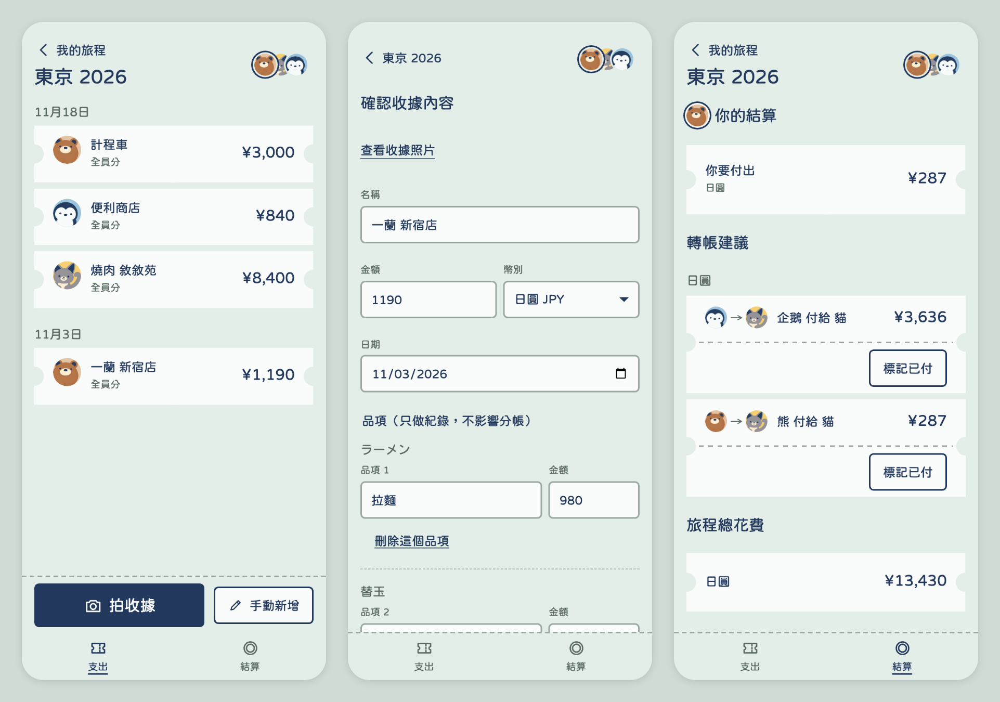

# 誰付錢

朋友出國旅行用的多人分帳 PWA：誰付了錢就記下來，拍收據自動辨識，回國前用最少的轉帳一次結清。

🔗 [Live Demo](https://who-pays.who-pays.workers.dev)　｜　朋友點旅程分享連結就能加入，不需註冊；只有擁有者能建立旅程



## Features
- **免註冊加入**：點分享連結、選一個頭像就能開始記帳，LINE 裡點開會自動改用外部瀏覽器
- **拍收據辨識**：讀出店名、金額、幣別與品項，日文品項附中文翻譯，確認後才存成支出
- **多幣別結算**：依幣別分開算淨額，給出轉帳次數最少的還款建議，標記已付後自動更新
- **即時同步**：同一趟旅程的成員同時記帳，畫面與結算即時更新
- **PWA**：可加到 iPhone 主畫面；部署新版後，在不打斷填寫或辨識的時機自動更新

## Tech Stack
- **React 19 + Vite + TypeScript（strict）**：純前端 PWA，外部資料都經過型別守衛；金額一律用整數的最小貨幣單位，避免浮點誤差
- **Supabase（Postgres、RLS、RPC、Realtime、Storage、Edge Functions）**：朋友以匿名登入加入，權限由 RLS 與 `security definer` RPC 在資料庫層把關，不依賴前端檢查
- **TanStack Query**：快取旅程資料；Realtime 收到變更時只讓該旅程的查詢重新整理
- **Gemini（structured output）**：直接回傳固定格式的 JSON，只在 Edge Function 內呼叫，API 金鑰不會進到瀏覽器
- **vite-plugin-pwa**：提供加到主畫面，並偵測新版本、挑安全的時機套用
- **OpenSpec + Vitest／pgTAP／Playwright**：需求寫成可驗證的 Scenario，測試標註對應的 Scenario，CI 產生對照報告（目前 68 / 115 個有自動測試）

## Highlights
**問題**：Gemini 尖峰時常回 503，辨識可能要等 15 到 60 秒。使用者等不到結果，或在等待時誤觸畫面，已上傳的照片和辨識結果就會白白浪費。

**解法**：
- **Edge Function 端**：25 秒共用一個時間上限，遇到 500／503 在上限內重試一次，並分辨「服務太忙」和「單純逾時」，顯示不同的提示。
- **前端**：辨識時切成整頁等待畫面，超過 15 秒提示可以改成手動新增。
- **失敗或中途離開**：任何失敗都直接開啟「已附上照片」的手動新增畫面；中途離開則刪除這次上傳的照片。

**結果**：拍下的收據一定會有結果，不是辨識完成，就是帶著照片進入手動輸入，不需要重拍，也不會在 Storage 留下沒有用到的照片。失敗訊息與等待畫面的行為由單元測試與 E2E 驗證。
<!-- TODO: 若有實際數據（例如辨識成功率、平均辨識時間），補在結果中 -->

## Getting Started
```bash
npm ci
cp .env.example .env.local   # 填入本機 Supabase（supabase start）的 anon key
npm run dev
```
需要 Node.js 22.12+、Docker（或 OrbStack）與 Supabase CLI；本機擁有者帳號、測試與部署步驟見 [docs/development.md](docs/development.md)。

---
👤 zooroy ・ [GitHub](https://github.com/zooroy)
